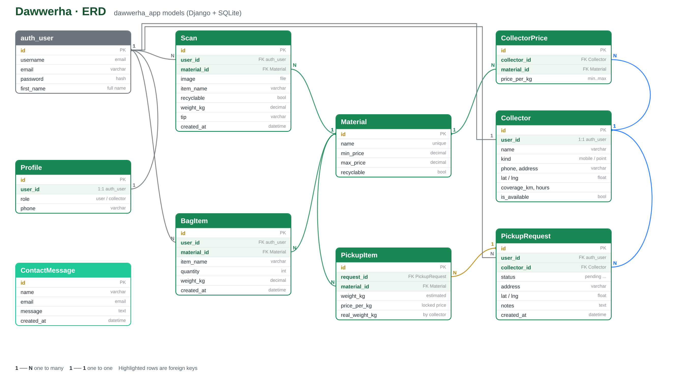
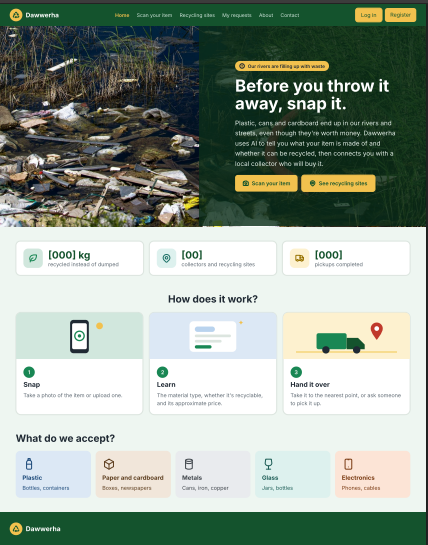
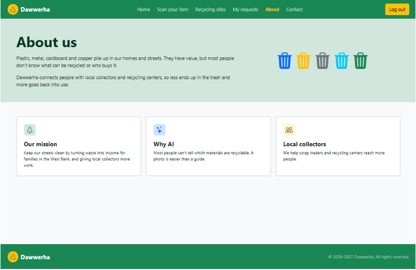
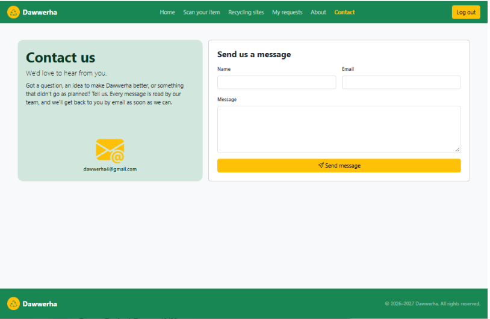
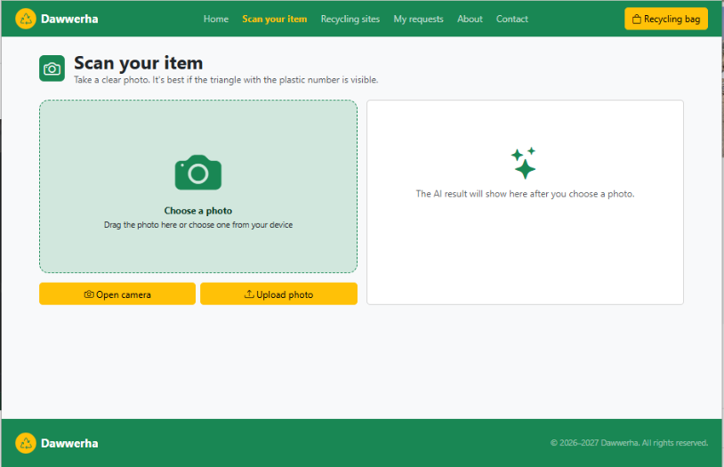
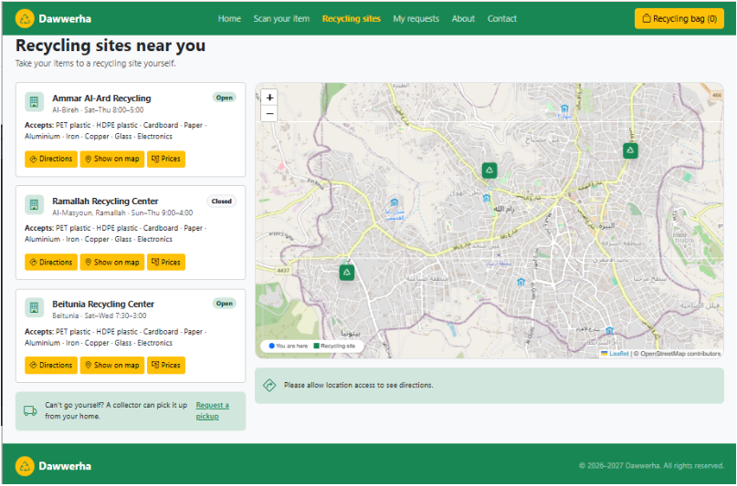
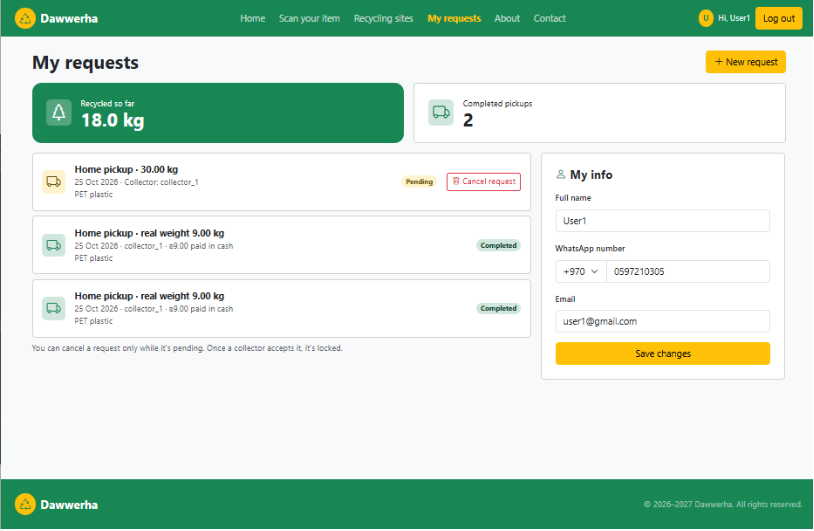
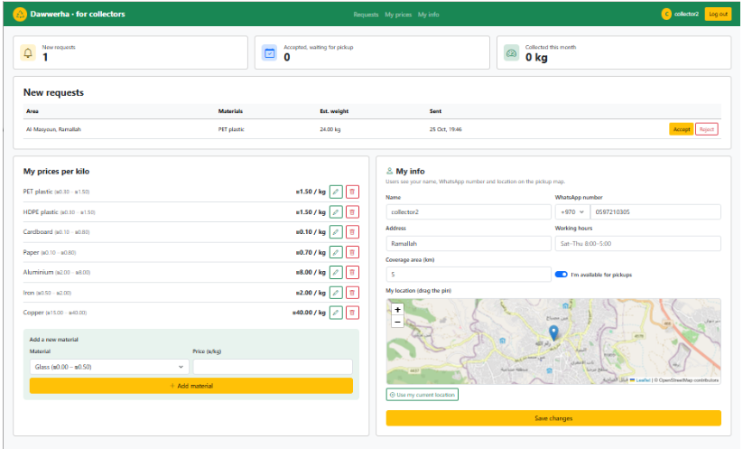
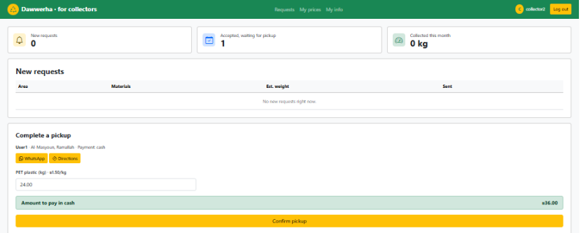

# ♻️ Dawwerha (دوّرها)

Dawwerha is a recycling web app for the West Bank. Bottles, cans and cardboard pile up on our streets even though scrap dealers pay for them. With Dawwerha, you snap a photo of an item and the AI tells you what material it is, whether it can be recycled and roughly how much it's worth. You can then take it to a nearby recycling site yourself, or ask a local collector to pick it up from your home and pay you in cash.

🌐 **Live site:** https://13.60.208.112.sslip.io/

---

## ✨ Features

### 👤 For users
- 🔐 Create an account, log in and log out.
- 📸 Scan an item with the camera or upload a photo, and get the AI's result: the material, whether it's recyclable and its approximate price.
- 🛍️ Add scanned items to a recycling bag, and change the quantity or weight of each item.
- 🚚 Request a home pickup once the bag reaches 5 kg.
- 🗺️ See recycling sites on a map, with their opening hours, the materials they accept and directions.
- 📋 Follow your pickup requests, cancel a request while it's still pending, and update your contact details.

### 🧑‍🔧 For collectors
- 🔔 See new pickup requests and accept or reject them.
- 💰 Set your own price per kilo for each material.
- 📍 Update your contact details, working hours, coverage area and location on the map.
- ⚖️ Complete a pickup by entering the real weight, and see the amount to pay the user in cash.

---

## 🛠️ Built with

- 🐍 Python and Django
- 🗄️ SQLite
- 🎨 HTML and Bootstrap 5
- 🔣 Bootstrap Icons
- ⚡ JavaScript
- 🗺️ Leaflet and OpenStreetMap for the maps
- ☁️ AWS for deployment

---

## 🗂️ Database design (ERD)

---

## 📸 Screenshots

### 🌍 Public pages

#### 🏠 Home page

#### ℹ️ About

#### ✉️ Contact

### 👤 User pages

#### 📷 Scan your item

#### 🗺️ Recycling sites

#### 📋 My requests

### 🧑‍🔧 Collector pages

#### 📊 Collector dashboard

#### ✅ Completing a pickup

---

## 👥 Team

- 👩‍💻 Dina Aslan
- 👩‍💻 Shereen AbuAwwad
- 👨‍💻 Bara Salah